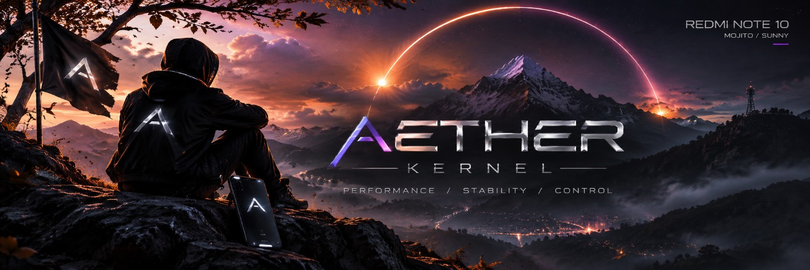

  

  

  

  
  
  
  

---

### ⚡ About Me

I am an **Embedded Systems, Linux Kernel, and Firmware Engineer** focused on low-latency operating system development, hardware-software co-design, and real-time processing architectures.

* 🐧 **Kernel Engineering:** Author of [**AETHER Kernel**](https://github.com/kiran-embedded/AETHER-Kernel-mojito) for Qualcomm SM6150 (Snapdragon 678), implementing Ring-0 sysfs companions, hardware AMOLED DC Dimming, Sunlight HBM, AOD backlight clamping, and BadUSB hardware shields.
* 🛡️ **System Hardening:** In-kernel security enhancements including memory leak audits, `kptr_restrict` information leak blocking, protected VFS traversal, eBPF constant blinding, and Android 17 `memfd` vendor compatibility fallbacks.
* 📡 **Firmware & IoT:** Designing firmware for ESP32 and ARM Cortex microcontrollers with real-time sensor loops, power-efficient sleep states, and cloud synchronization.
* 🎧 **Acoustic & Audio DSP:** Engineering real-time microphone filters, hardware unmute timing, and high-pass frequency DSP algorithms directly on Linux ALSA and Android audio HALs.

---

### 🛠️ Technical Stack & Skills

  <b>Languages & Low-Level Programming</b> 
  
  
  
  
  
  

  <b>Operating Systems & Kernel Development</b> 
  
  
  
  
  
  

  <b>Hardware, Microcontrollers & Protocols</b> 
  
  
  
  
  

  <b>Tooling & Infrastructure</b> 
  
  
  
  
  

---

### 🚀 Featured Engineering Projects

<table>
  <tr>
    <td width="50%">
      <h3 align="center">⚡ AETHER Kernel</h3>
      

        <b>Flagship Linux Kernel Subsystem for Xiaomi Redmi Note 10</b>
      

      <ul>
        <li><b>Zero-Root Quick Settings:</b> 9 companion tiles with live SystemUI synchronization.</li>
        <li><b>Hardware AOD Clamping:</b> Clamps doze backlight to level 20 (10%) and balanced ceilings.</li>
        <li><b>BadUSB Cutoff:</b> Drops malicious peripheral enumeration while preserving 33W Fast Charging.</li>
        <li><b>Memory Optimizations:</b> Upstream MGLRU and ZRAM single-page I/O.</li>
      </ul>
      

        <a href="https://github.com/kiran-embedded/AETHER-Kernel-mojito"><b>View Repository →</b></a>
      

    </td>
    <td width="50%">
      <h3 align="center">📡 IoT & Embedded Firmware</h3>
      

        <b>Smart Lighting, Sensors & Real-Time Controllers</b>
      

      <ul>
        <li><b>Aurexa Smart Lighting:</b> Cloud-connected embedded ambient control.</li>
        <li><b>ESP32 + Firebase IoT:</b> Low-power sensor telemetry and bidirectional synchronization.</li>
        <li><b>Firmware State Machines:</b> Non-blocking task loops with fail-safe recovery watchdogs.</li>
      </ul>
      

        <a href="https://github.com/kiran-embedded?tab=repositories"><b>Explore Firmware Repositories →</b></a>
      

    </td>
  </tr>
  <tr>
    <td width="50%">
      <h3 align="center">🎧 Audio & DSP Processing</h3>
      

        <b>Real-Time Audio Pipelines & HAL Calibration</b>
      

      <ul>
        <li><b>Hardware Mic HPF:</b> In-tree DSP noise filtering (Flat, 75Hz Vocal, 150Hz Wind).</li>
        <li><b>Fast Unmute Delay:</b> 40ms fast ramp eliminating speech clipping on voice calls.</li>
        <li><b>Direct Hi-Fi Codec Routing:</b> Bit-perfect audio path bypassing Android resamplers.</li>
      </ul>
      

        <a href="https://github.com/kiran-embedded/AETHER-Kernel-mojito"><b>Inspect Audio Subsystems →</b></a>
      

    </td>
    <td width="50%">
      <h3 align="center">🛡️ Root & Stealth Integration</h3>
      

        <b>KernelSU-Next & SuSFS Kernel Extensions</b>
      

      <ul>
        <li><b>Native UAPI v5:</b> Integrated KernelSU-Next without userspace daemon overhead.</li>
        <li><b>SuSFS v2.3.0:</b> Kernel-level filesystem spoofing for root hiding and integrity.</li>
        <li><b>Hardware Volume-Key Watchdog:</b> Autonomous rescue mode preventing bootloops.</li>
      </ul>
      

        <a href="https://github.com/kiran-embedded/AETHER-Kernel-mojito"><b>Check Security Implementations →</b></a>
      

    </td>
  </tr>
</table>

---

### 📊 Engineering Activity & Statistics

  

  

---

  

