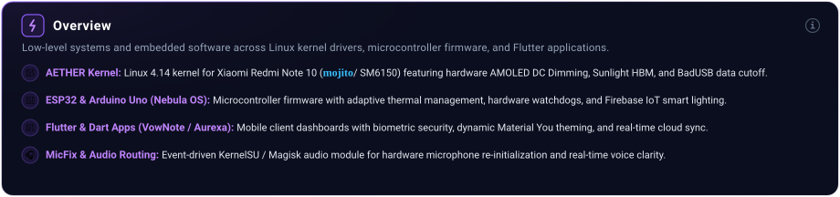
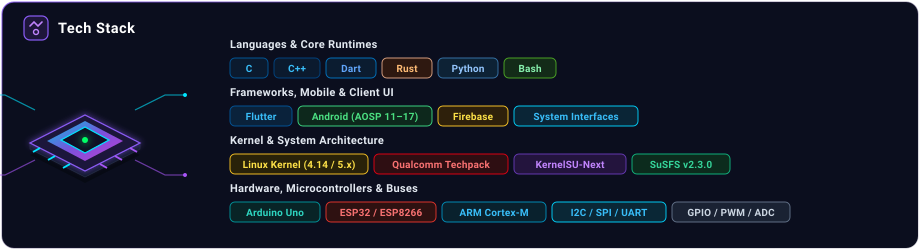
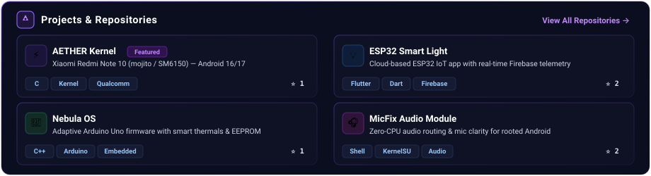
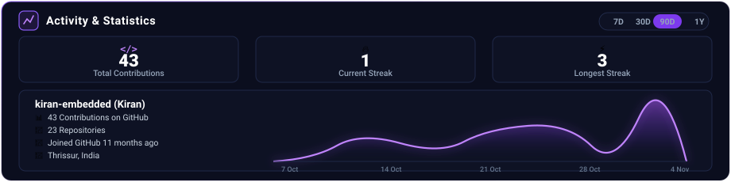

<!-- 1. Cosmic Planetary Hero Banner -->

<!-- 2. Terminal Window Hero -->

<!-- 3. System Architecture Overview Card -->

<!-- 4. Tech Stack with 3D Microprocessor & Categories -->

<!-- 5. 2x2 Projects & Repositories Grid -->

<!-- 6. Activity Metrics & Wave Area Chart -->

<!-- 7. Cosmic Horizon Footer Banner -->

