<!-- Precision Single-Color Pixel LED Hardware Card -->

  
  
  
  
  

---

### ⚡ Overview

I design and build low-level systems spanning **Linux kernel drivers**, **microcontroller firmware**, and **cross-platform client interfaces**:

* 🐧 **Kernel Engineering:** Author and maintainer of [**AETHER Kernel**](https://github.com/kiran-embedded/AETHER-Kernel-mojito) for Qualcomm SM6150 (Snapdragon 678), implementing hardware AMOLED DC Dimming, Sunlight HBM, AOD backlight clamping, BadUSB data isolation, and rootless sysfs companion integration.
* 🔌 **Embedded & Microcontrollers:** Firmware development for **ESP32**, **Arduino Uno**, and **ARM Cortex** platforms utilizing FreeRTOS tasks, hardware interrupts, power management, and communication buses (I2C, SPI, UART).
* 📱 **Mobile & Dashboard Development:** Responsive control interfaces engineered with **Flutter** and **Dart**, coupled with native Android system services for hardware telemetry and real-time state synchronization.
* 🎧 **Acoustic & Audio DSP:** In-tree microphone noise filtering, hardware unmute ramp tuning, and direct ALSA routing to deliver clean audio signal paths.

---

### 🛠️ Technical Stack

  <b>Languages & Core Runtimes</b> 
  
  
  
  
  
  
  

  <b>Frameworks, Mobile & Client UI</b> 
  
  
  
  

  <b>Kernel & System Architecture</b> 
  
  
  
  
  

  <b>Hardware, Microcontrollers & Buses</b> 
  
  
  
  
  

---

  

### 🚀 Projects & Repositories

<table>
  <tr>
    <td width="50%">
      <h3 align="center">⚡ AETHER Kernel</h3>
      

        <b>Linux Kernel Subsystem for Qualcomm SM6150 (Redmi Note 10)</b>
      

      <ul>
        <li><b>Rootless Quick Settings:</b> 9 system tiles interfacing with sysfs nodes.</li>
        <li><b>Hardware AOD Backlight Clamping:</b> Night Dim mode and configurable ambient ceilings.</li>
        <li><b>USB Data Shield:</b> Denies malicious peripheral enumeration while keeping 33W fast charging active.</li>
        <li><b>Memory Tuning:</b> Multi-Gen LRU (MGLRU) and single-page ZRAM compression.</li>
      </ul>
      

        <a href="https://github.com/kiran-embedded/AETHER-Kernel-mojito"><b>View Repository →</b></a>
      

    </td>
    <td width="50%">
      <h3 align="center">📱 Flutter & Cross-Platform UI</h3>
      

        <b>Responsive Hardware Telemetry & Control Dashboards</b>
      

      <ul>
        <li><b>Flutter Dashboards:</b> Cross-platform applications for real-time telemetry and controls.</li>
        <li><b>Hardware Interfacing:</b> Direct serial, BLE, and REST/WebSocket integration with microcontrollers.</li>
        <li><b>Native Android Services:</b> Standalone background services and SystemUI Quick Settings integration.</li>
      </ul>
      

        <a href="https://github.com/kiran-embedded?tab=repositories"><b>Explore Projects →</b></a>
      

    </td>
  </tr>
  <tr>
    <td width="50%">
      <h3 align="center">📡 Embedded IoT & Firmware</h3>
      

        <b>ESP32 &amp; Arduino Uno Hardware Systems</b>
      

      <ul>
        <li><b>Arduino Uno Systems:</b> Sensor reading, PWM actuator control, and serial telemetry protocols.</li>
        <li><b>ESP32 Cloud Gateways:</b> Bi-directional cloud synchronization with Firebase and MQTT.</li>
        <li><b>Failsafe Architecture:</b> Hardware watchdog timers and non-volatile state restoration.</li>
      </ul>
      

        <a href="https://github.com/kiran-embedded?tab=repositories"><b>View Firmware Code →</b></a>
      

    </td>
    <td width="50%">
      <h3 align="center">🎧 Audio & DSP Processing</h3>
      

        <b>Acoustic Processing &amp; Audio Routing</b>
      

      <ul>
        <li><b>Microphone HPF Filtering:</b> Real-time high-pass noise attenuation (75Hz / 150Hz).</li>
        <li><b>Fast Unmute Delay:</b> 40ms fast ramp to eliminate speech clipping during calls.</li>
        <li><b>Direct Codec Path:</b> Bypasses userspace resampling for direct hardware audio fidelity.</li>
      </ul>
      

        <a href="https://github.com/kiran-embedded/AETHER-Kernel-mojito"><b>Inspect Audio Subsystem →</b></a>
      

    </td>
  </tr>
</table>

---

### 📊 Activity & Statistics

  

  

  

